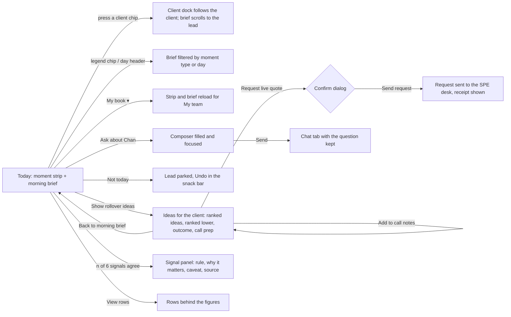

# HK ELI Chatbot · web

Angular 21 front end for the HK ELI Chatbot widget inside the Digimarkets workspace. It starts with the RM flow, tab 1 (Today).

## Run it

```bash
npm ci            # .npmrc sets legacy-peer-deps (works around an npm 10 bug with jsdom's optional canvas peer)
npm start         # http://localhost:4200/rm/today
npm test          # Vitest, single run
npm run build     # production build in dist/web
```

To see the other states without a back end, add one of these to the URL: `?scenario=empty`, `?scenario=error` or `?scenario=slow`.

## What the Today flow does



Every view has its loading, error and empty state. "Nothing is sent outside the chatbot" until the RM confirms (the live-quote request).

## Layout

| Path | What it holds |
| --- | --- |
| `src/styles/_tokens.scss` | Design tokens (`--eli-*`) from the Digimarkets style guide. Every colour, size and radius in a component comes from here. |
| `src/tailwind.css` | Tailwind 4: theme and utilities only (no preflight), `tw:` prefix, own palette off and mapped to tokens. |
| `src/app/shell/` | Digimarkets top bar, application rail and widget frame (title bar, tab rail), from the HK ELI Figma. |
| `src/app/core/config/` | Runtime config, loaded from `public/config/app-config.json` before start-up. No URLs, limits or windows in code. |
| `src/app/core/data/` | `TodayDataSource` (the contract), the mock (fixtures, latency, scenarios) and the gateway client. Config picks one. |
| `src/app/core/time/` | Business-day maths (weekends and configured holidays) and the clock. |
| `src/app/core/trace/` | Adds one W3C `traceparent` to every request for OpenTelemetry. |
| `src/app/features/today/` | The Today tab: `TodayStore` (signals), strip, brief, lead cards, ideas, dock, composer. |

## Configuration (`public/config/app-config.json`)

| Key | Meaning |
| --- | --- |
| `dataSource` | `mock` or `gateway` |
| `gatewayBaseUrl`, `requestTimeoutMs` | Where the gateway is, and how long a call may take before it fails visibly |
| `mockLatencyMs`, `mockScenario` | Mock behaviour (`normal`, `empty`, `error`, `slow`) |
| `asOfDate`, `timeZone`, `marketHolidays` | "Today" (null means the real date in the time zone) and the calendar |
| `businessDaysAhead` | Days in the moment strip (10) |
| `briefLeadLimit` | Leads shown before "Show more" (3) |
| `concentrationWarnRatio` | Share of the limit at which a concentration bar warns (0.85) |
| `maturingWindowBusinessDays` | Outcome window for a lead (10) |

## Standards applied

- Angular 21.2.25 (CLI 21.2.24), Material and CDK 21.2.14, TypeScript 5.9.3, RxJS 7.8.2, tslib 2.8.1, Vitest 4.1.11 with jsdom 28.1.0, Tailwind 4.3.3 with PostCSS 8.5.29, lucide-static 1.51.0. All pinned exactly; `piscina` overridden to 5.3.2.
- Standalone components, signals and `rxResource`, built-in control flow, zoneless change detection, lazy routes.
- Keyboard use, visible focus, labels on every icon button, reduced motion respected, colour never the only carrier of meaning.

### Departures to confirm with the project owner

- **Look:** Digimarkets style guide (dark widget, Open Sans, orange caps title), not the NPA/Inter look in the standards sheet, as Hawk decided. Font: `@fontsource-variable/open-sans` 5.3.0 (OFL-1.1), self-hosted, in place of Inter. Needs adding to the pinned versions table.
- **Name and agents:** "HK ELI Chatbot", never Ask MIRA; Stork AI orchestrates (Gemini adapter), no Dify.
- **Node:** built and tested here on Node 22.23; the bank's pinned Node 24.16.0 also fits Angular 21.
- **Light theme:** Digimarkets widgets are dark only, so only the dark set exists. Tokens are ready for a light set.
- **`npm audit`:** the shipped bundle is clean (`npm audit --omit=dev`: 0). Build-time tooling reports advisories inherited from the Angular 21 CLI (see standards section 6).

*Will be part of Ask-MIRA in future.
